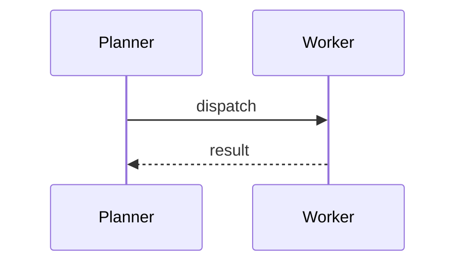

# Markdown components

The build extends Markdown with fenced components. They are parsed by
`engine/render.py` and rendered to static HTML; components that need browser
behavior get a small external script.

## Mermaid diagrams

Use a standard Mermaid fence:

````markdown

````

The build emits a `<pre class="mermaid">` block. Mermaid is vendored from the
`mermaid` npm dependency and loaded only on pages that contain a diagram. The
diagram re-renders when the site theme changes.

Rules:

- Use normal Mermaid syntax. Do not add HTML or scripts to the block.
- Keep the diagram reasonably compact; it is rendered inside the article column
  and scales to fit.
- The library is client-side. If Mermaid cannot parse a diagram, the block shows
  `Diagram could not be rendered.` and the rest of the post still renders.

## Timeline

Use a `timeline` fence. The first line is an optional title. Every other
non-empty line is an event:

```
```timeline
title: Optional timeline title
date | event | optional description | optional kind
```
```

Fields:

| Field | Required | Notes |
|---|---|---|
| `date` | yes | Display text. Not parsed as a date, so `Late Sep – early Oct` is valid. |
| `event` | yes | The headline for the event. |
| `description` | no | Supporting text. Inline code with backticks is supported. |
| `kind` | no | `release`, `fix`, `incident`, `actor`, or `default`. Controls the badge and filter. |

Behavior:

- Fields are separated by `|`. Do not use a literal `|` inside a field.
- Blank lines are ignored. Lines starting with `#` are comments.
- The component renders a vertical timeline with kind badges and filter buttons.
  Filtering is handled by `assets/js/timeline.js`; without JavaScript the full
  timeline is still readable.
- `kind` colors: release = accent, fix = success, incident = error, actor =
  warning, default = muted.

Example:

````markdown
```timeline
title: Release timeline
2026-01-10 | First commit | `abc123`, initial import | release
2026-01-12 | Auth bypass fixed | Fail-closed on database errors | fix
2026-01-14 | Public exploit published | | incident
2026-01-15 | Upstream repository removed | Mirror remains at `org/project` | actor
```
````

## Adding a component

1. Add the renderer branch to `_code_block` in `engine/render.py`.
2. Emit semantic HTML from Python. Escape all content; only opt in to inline
   markup explicitly.
3. Put presentation in `assets/css/prose.css` (or the relevant component
   stylesheet).
4. Put behavior in `assets/js/<component>.js` and load it only on pages that
   need it (see `has_mermaid` / `has_timeline` in `engine/pages.py` and
   `templates/pages/blog_post.html`).
5. Add a build/test assertion for the generated HTML.
