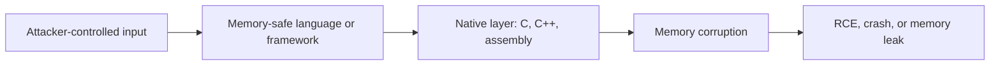

In about a month, five named memory-safety bugs hit foundational software: PHP2Shell
(PHP), Brotli2Shell (the Brotli C decoder), Java4Shell (OpenJDK HotSpot), nginx2root
(nginx HTTP/2), and Ruby2Shell (Ruby's C runtime). Four of the five are typically reached through a memory-safe language or framework.
All five sit in C, C++, or hand-written assembly.

The pattern is not “memory-safe languages failed.” It is narrower and more useful:
**the attacker-reachable code is the native layer underneath the safe language, and AI
has made that layer cheap to audit.** Rust and Go move the boundary; they do not remove
it.

## What we looked at

| Name | CVE | Component | Bug layer | Bug class | Reachability | Status |
|---|---|---|---|---|---|---|
| PHP2Shell | CVE-2026-109618, CVE-2026-109619 | PHP Zend engine | C | OOM/state corruption | Pre-auth, default configs | Fixed 8.5.12/8.4.27/8.3.36/8.2.35 |
| Brotli2Shell | CVE-2026-111497 | Brotli decoder | C | OOB write (CWE-252) | Crafted Brotli input | Fixed 1.0.10/1.1.1/1.2.1; CISA KEV |
| Java4Shell | CVE-2026-114938 | HotSpot Base64 intrinsic | C++/asm | OOB write | Base64 decode path | Fixed 17.0.21.1 and siblings |
| nginx2root | CVE-2026-123007 | nginx HTTP/2 | C | Integer underflow → OOB | HTTP/2, pre-auth | Fixed 1.31.9/1.30.7 |
| Ruby2Shell | CVE-2026-132825 | Ruby `case_map` | C | Off-by-one heap write | Pre-auth via Rack | Fixed 3.3.14/3.4.13/4.0.10 |

The reach is the point:

| Case | Scale signal |
|---|---|
| PHP2Shell | Calif cites up to ~70% of websites running PHP |
| Brotli2Shell | Node.js, .NET, Python, Envoy, Istio, FFmpeg; Akamai says 61% of networks ran affected Node.js |
| Java4Shell | Java is cited as running in ~90% of Fortune 500 companies |
| nginx2root | nginx is cited as powering ~225 million sites |
| Ruby2Shell | Bundled in GitLab, GitHub Enterprise Server, Chatwoot, and other self-hosted products |

These are vendor and press figures, not independent measurements. They show why the bugs
matter, not exact prevalence.

### Timeline

```timeline
title: Five "2shell" bugs in thirty days (2026)
21 Oct | PHP2Shell advisory | Node.js discloses Brotli2Shell on the same day | release
22 Oct | Brotli2Shell CVE published | `CVE-2026-111497` | release
27 Oct | CISA adds Brotli to KEV | Known Exploited Vulnerabilities catalog | incident
17 Nov | Java4Shell | `CVE-2026-114938` | release
18 Nov | nginx2root | `CVE-2026-123007` | release
19 Nov | Ruby2Shell | `CVE-2026-132825` | release
```

Five named memory-safety bugs in thirty days.

## Case files

### PHP2Shell: OOM and stale state in the Zend engine

Two CVEs, both in PHP's C implementation:

- CVE-2026-109618: an out-of-memory fatal interrupts request initialization while
  internal data is partly initialized. Cleanup later treats the invalid data as valid.
- CVE-2026-109619: request-owned state survives after its backing memory is freed; a later
  request on the same worker uses the stale state before initialization resets it.

The first bug is visible in `Zend/zend_hash.c`:

```c
/* PHP 8.4 */
idx = ht->nNumUsed++;
ht->nNumOfElements++;

p = ht->arData + idx;
p->key = key = zend_string_init(str, len, /* ... */);  /* may zend_bailout() */

p->h = ZSTR_H(key) = h;
ZVAL_COPY_VALUE(&p->val, pData);
```

The counts are published before the key allocation, which can fatal. If it does,
`nNumUsed` still includes the half-built bucket, and teardown walks it:

```c
for (p = ht->arData; p < ht->arData + ht->nNumUsed; p++) {
    i_zval_ptr_dtor(&p->val);
    if (p->key) {
        zend_string_release(p->key);
    }
}
```

That is the general pattern Calif described: publish or destroy state, perform fallible
work, and skip the commit or rollback when a nonlocal fatal occurs. The surviving
consumer trusts the false state.

Calif, OpenAI, and Wiz found it with AI assistance. The writeup says the first useful
finding came “only a few days after starting the audit,” and the LLM generalized the
pattern into a reusable review checklist. The affected range reaches back to PHP 5.4.0;
fixed releases are 8.5.12, 8.4.27, 8.3.36, and 8.2.35. PHP 8.1 and older are EOL; the
team provided minimal backports for 7.4, 8.0, and 8.1.

### Brotli2Shell: a C decoder under every runtime

CVE-2026-111497 is an out-of-bounds write in Google's Brotli decoder (`c/dec/decode.c`),
versions 1.0.3 through 1.2.0. The advisory maps it to CWE-252, unchecked return value.
The upstream fix changes the block-type/length decoder from a boolean to an error code
and propagates “needs more input” and “invalid stream” instead of continuing:

```diff
-static BROTLI_INLINE BROTLI_BOOL DecodeBlockTypeAndLength(...)
+static BROTLI_INLINE BrotliDecoderErrorCode DecodeBlockTypeAndLength(...)
...
-    return BROTLI_FALSE;
+    return BROTLI_DECODER_ERROR_FORMAT_BLOCK_SWITCH;
...
-    return BROTLI_TRUE;
+    return BROTLI_DECODER_SUCCESS;
```

The bug matters because Brotli is embedded everywhere: Node.js, Bun, .NET, Envoy, Istio,
Python's `brotli`/`brotlicffi`, PHP's Windows builds, FFmpeg through libjxl, Apache Arrow,
and ClickHouse. A crafted compressed stream can be a request body, a response, or a file.
CISA added it to the KEV catalog on October 27, 2026. Public PoCs exist; Imperva and ELLIO
reported code execution against specific Node.js builds, and ELLIO noted the exploit has
to be tuned per build and often crashes the worker instead. CVSS 4.0 is 9.2; EPSS was
82.6% at the time of the Tenable writeup.

This is the cleanest example of the thesis: the runtime language is memory-safe, the
decoder is C, and the decoder is what the attacker reaches.

### Java4Shell: the JVM's hand-written Base64 decoder

CVE-2026-114938 is an out-of-bounds write in HotSpot's x86-64 AVX-512 VBMI Base64 decode
intrinsic. Java the language is memory-safe; the intrinsic is C++ generating hand-written
assembly.

The tail handler computes `output_size = (length / 4) * 3`, then decrements it for padding
without a non-negative check. A padding-only tail makes it `-1`. `BZHI` reads the low byte
of the count, which is 255, so it leaves all 64 bits of the store mask set:

```c
__ movq(output_mask, -1);
__ bzhiq(output_mask, output_mask, output_size);
...
__ evmovdqub(Address(dest, dp), k1, tmp, true, Assembler::AVX_512bit);
```

The 64-byte store starts two bytes before the allocated output ends. On JDK 17, the
129-byte input `"A" * 128 + "="` allocates 98 bytes and writes 62 bytes past them. The
patch adds a four-line guard sending tails shorter than four bytes to the scalar decoder.

Calif reports one hour to find and two hours to first exploit, under $200 in tokens. The
affected range starts at 17.0.6, when the optimization was backported from JDK 18. The
bug is not in Java application code; it is in the runtime's optimization.

### nginx2root: a 64-bit window fed by 31-bit increments

CVE-2026-123007 is an integer underflow in nginx's HTTP/2 connection flow control. Cleanup
refunds queued DATA credit after the client has already raised the connection window,
pushing `h2c->send_window` past `2^31-1`. The next `WINDOW_UPDATE` check subtracts that
value from the maximum using unsigned arithmetic, wraps, and accepts more increments:

```c
if (window > NGX_HTTP_V2_MAX_WINDOW - h2c->send_window) {
    return ngx_http_v2_connection_error(h2c, NGX_HTTP_V2_FLOW_CTRL_ERROR);
}
h2c->send_window += window;
```

Enough increments move the counter past `2^63`; the cast to signed `off_t` becomes
negative, a shadow buffer ends up with `last` before `pos`, and the TLS path passes a huge
unsigned length to `memcpy`. The fix tracks queued DATA in `send_queued` and includes it in
the check.

The full RCE is reported to need about 128 GB of traffic: 2^33 `WINDOW_UPDATE` frames at
13 bytes each, plus request-header carriers, plus TLS overhead. The crash needs about
60 GiB. We reproduced the crash: 306 seconds, `worker process 8 exited on signal 11`.
The traffic is a counter-walking cost, not a bandwidth amplifier.

### Ruby2Shell: a one-byte overflow before Rails authentication

CVE-2026-132825 is a one-byte heap overflow in Ruby's `case_map` for 14 single-byte
encodings. The loop checks for one byte of room, then writes two for `ß`:

```c
while (*pp < end && to < to_end) {
  code = *(*pp)++;
  if (code == SHARP_s) {
    if (flags & ONIGENC_CASE_UPCASE) {
      *to++ = 'S';
      code = (flags & ONIGENC_CASE_TITLECASE) ? 's' : 'S';
    }
    ...
  }
  *to++ = code;
}
```

The output buffer is the input length plus 20. Twenty-one `ß` characters leave one byte of
room for the last two-byte write. The patch changes the condition to `to_end - to > 1`.

The pre-auth path is `Rack::MethodOverride`: a multipart field named `_method` with
`Content-Type: text/plain; charset=ISO-8859-1` is tagged ISO-8859-1 by Rack's multipart
parser, then `method.to_s.upcase` runs in middleware before the app. Rails includes that
middleware unless the app is API-only; Sinatra classic enables it by default. ASan reports
the one-byte write in `case_map` at `enc/iso_8859_1.c:293`; the patched build is clean. The
CVE record scores it `AV:L/AC:H` 7.4, which does not describe the network path.

The discoverers are credited as Stephan Lipp (Ada Logics) and Anthropic. Veria Labs named
it Ruby2Shell and plans to publish its exploit PoC later.

## The common shape

| Stack | “Safe” layer | Where the bug lives |
|---|---|---|
| PHP app | PHP language | Zend engine (C) |
| Node.js / .NET / Python | JS / C# / Python | Brotli decoder (C) |
| Java app | Java language | HotSpot C++ and AVX-512 assembly |
| nginx | Config | nginx C |
| Ruby app | Ruby language | MRI C |
| Go service | Go language | Go compiler |
| Rust service | Rust language | `unsafe`/FFI/native crates |



The safe layer is real. It is also not where the bug is.

Two kinds of code keep producing these bugs:

1. **Performance code.** Base64 intrinsics, SIMD memcpy, Brotli block decoding, JIT
   bounds-check elimination. These paths exist to go faster than the safe abstraction, so
   they bypass or reimplement its checks.
2. **Compatibility code.** Legacy encodings, old protocol versions, MIME and form parsing,
   request cleanup paths. These paths exist to keep old behavior working, so they carry
   state machines and edge cases that newer code avoids.

Neither is a reason to remove the feature. Both are reasons to treat the native layer as
the security boundary it is.

## Why now

Most of these bugs are old. Ruby2Shell dates to 2.4.0; PHP2Shell's earliest path dates to 5.4.0;
Brotli's flaw existed for years; nginx's HTTP/2 code dates to 2015. What changed is the
cost of finding them.

AI attribution is uneven:

| Case | AI involvement | Evidence |
|---|---|---|
| PHP2Shell | Calif, OpenAI, Wiz; LLM companion and generalized review pattern | Calif writeup |
| Java4Shell | Calif with AI; 1 hour to find, 2 hours to first exploit | Calif writeup |
| nginx2root | Wiz Atlas with multiple models; several independent teams | Wiz writeup |
| Ruby2Shell | Stephan Lipp (Ada Logics) and Anthropic credited | Ruby advisory |
| Brotli2Shell | No public AI attribution in the sources read | Fix predates disclosure |

- **AI-assisted audit at scale.** Calif's PHP2Shell writeup describes an LLM companion,
  parallel review, and a generalized `SKILL.md` for the “publish state, do fallible work,
  skip commit” pattern. Java4Shell was found and exploited in hours for under $200 in
  tokens. Wiz used its Atlas harness and multiple models; Anthropic reports 62 Chrome
  CVEs, a Safari same-origin bypass chain, an Android lock-screen bypass, a Windows QUIC
  remote DoS, and a Linux MPTCP zero-click RCE found with Claude.
- **Patch diffs are public.** Once a fix lands, the vulnerable function and often the
  trigger are visible. AI can diff the patch and generate a harness or a variant in
  minutes.
- **Multiple independent teams.** PHP2Shell was reported by Calif, OpenAI, and Wiz.
  nginx2root was independently found by Wiz, Ikotas Labs, Metnir, Rapid7, and Xint.
  Brotli2Shell had public PoCs and in-the-wild attempts within days. The same bug being
  found by several teams is a sign that discovery is no longer the bottleneck.
- **Exploit generation.** Anthropic's Chrome and Linux chains show multi-step exploits
  built with model assistance. The cost is still higher than finding the bug, but it is no
  longer a specialist-only project.
- **Compressed disclosure.** Brotli was added to CISA KEV six days after the Node.js
  advisory. PHP2Shell had exploitation attempts as patches landed. The window between
  “patch available” and “someone tries it” is short.

The point is not that every case was AI-found. The point is that the cost of finding the
ones that were has fallen far enough to change the disclosure pace.

## The language boundary

### Java

Java the language checks array bounds, nulls, and types. The JVM is C++ and assembly. The
Base64 intrinsic is a performance path inside HotSpot; the bug is a hand-written mask
calculation, not Java bytecode. The same boundary exists at JNI, the Foreign Function &
Memory API, and every native library a Java service loads. Java's memory safety is a
property of Java code, not of the process.

### Ruby, PHP, Python, Node.js, .NET

All five have memory-safe language semantics and native implementations or extensions:

- Ruby's MRI is C. Encoding tables, regex (Onigmo), and C extensions are native.
- PHP's Zend engine is C; extensions are C.
- Python's interpreter is C; C extensions and native packages are the boundary.
- Node.js runs JavaScript on V8 (C++), with C/C++ native addons and C libraries such as
  Brotli and OpenSSL.
- .NET runs C#/F# on a runtime with native components; Brotli, OpenSSL, and P/Invoke are
  native.

Brotli2Shell is the clean demonstration: Node.js, .NET, and Python were all exposed
through the same C decoder, regardless of their language safety.

### C and C++

nginx and Brotli are C. The bugs are integer underflow, unchecked return values, and
state-machine mistakes. These are not exotic; they are the ordinary failure modes of
large C codebases under attacker-controlled input. The difference is reachability:
HTTP/2 and Brotli decompression are default or near-default in huge deployments.

### Rust

Safe Rust enforces memory safety, but the guarantee stops at `unsafe`, FFI, assembly, and
compiler/runtime bugs. The 2026 RustSec memory-corruption list is a useful reality check:

- `zstd-safe` (RUSTSEC-2026-0398): a safe wrapper passed a C-reported length to
  `Vec::set_len`, leaving the `Vec` longer than its capacity. Reading it disclosed heap
  memory; appending corrupted memory.
- `libz-sys` (RUSTSEC-2026-0544): heap buffer overflow in the zlib binding.
- `openssl` (RUSTSEC-2026-0477, -0476, -0475, -0473, -0463): buffer overflows in AES key
  wrap, digest finalization, and key derivation.
- `rustls-ffi` (RUSTSEC-2026-0413): use-after-free of a caller-owned server name.
- `faster-hex` (RUSTSEC-2026-0306): the AVX2 path read past `src`.
- `heapless` (RUSTSEC-2026-0574 and related advisories): safe-code-reachable
  unsoundness, including a use-after-free.
- `metacall` (RUSTSEC-2026-0157): memory corruption through safe APIs.

None of these says Rust is unsafe. They say the boundary moved. A Rust service that uses
`unsafe`, a `-sys` crate, a SIMD fast path, or an FFI wrapper inherits the native layer's
bugs. The safe API is only as sound as the `unsafe` code behind it.

### Go

Go's compiler inserts bounds checks, and safe Go code is memory-safe in the usual sense.
Two boundaries matter:

- `unsafe`, `cgo`, and assembly. These bypass or reinterpret the safety checks, and they
  are common in crypto, networking, and performance code.
- The compiler and runtime themselves. CVE-2026-27143 is a bounds-check elimination bug in
  `cmd/compile`: loop induction variables could overflow or underflow in a way the
  compiler had proved in-bounds, allowing out-of-bounds indexing in safe Go. Fixed in Go
  1.25.9 and 1.26.2; CVSS 9.8. The Go vulndb summary is blunt: “Missing bound checks can
  lead to memory corruption in safe Go.”

That is the point. A memory-safe language is a proof carried by the compiler, the runtime,
and every native dependency. The proof can be wrong.

## Is “use Rust or Go” the answer?

No, not by itself.

What Rust and Go do well:

- They eliminate most spatial and temporal memory errors from application code.
- They make the unsafe boundary explicit (Rust) or small and auditable (Go's `unsafe`,
  `cgo`, assembly).
- They give developers better defaults for new code.

What they do not do:

- They do not make native dependencies safe. Brotli, zlib, OpenSSL, SQLite, libjxl, and
  FFmpeg are C.
- They do not make `unsafe`/FFI/assembly safe. The RustSec list above is the evidence.
- They do not prevent logic bugs: auth bypass, injection, path traversal, request
  smuggling, deserialization, protocol abuse.
- They do not prevent denial of service: unbounded allocation, algorithmic complexity,
  panics, decompression bombs.
- They do not remove supply-chain risk: build scripts, proc macros, `-sys` crates, cgo
  flags, bundled runtimes.
- They do not make compiler/runtime bugs impossible. Go's CVE-2026-27143 is the proof.

The honest claim is narrower: memory-safe languages reduce one class of bug in the code
you write. They do not remove the native dependencies, protocol code, or configuration
that make up the rest of the attack surface. A Rails app, a Node service, and a Rust
service can all call the same vulnerable Brotli decoder.

## What the future attack surface looks like

High confidence:

- **Performance code in managed runtimes.** JIT compilers, intrinsics, SIMD paths, and
  hand-written assembly will keep producing bugs. They are written to bypass the safe
  abstraction, and they are reachable from ordinary input (Base64, strings, regex,
  compression, crypto).
- **Protocol state machines.** HTTP/2, HTTP/3, QUIC, DNS, and TLS carry complex state and
  flow-control accounting. The nginx2root bug is a flow-control underflow; protocol logic
  will remain a rich source.
- **Compression and codecs.** Brotli, zstd, gzip, JPEG XL, FFmpeg, and PDF/image parsers
  process attacker-controlled bytes at scale. Brotli2Shell is the template.
- **Native dependencies in safe ecosystems.** The more a language ecosystem relies on
  `-sys` crates, cgo, native addons, or C extensions, the more it inherits C bugs.
- **Legacy compatibility.** Single-byte encodings, old protocol versions, MIME parsing,
  and form handling are kept for compatibility and carry edge cases.

Medium confidence:

- **AI-generated code increases the inflow.** The same models that find bugs can write
  code with subtle unsafe assumptions. The net effect depends on review and testing.
- **AI-assisted patching reduces the backlog.** Anthropic and others argue for scanning at
  PR time, not only for old code. If that becomes normal, the discovery advantage may
  shift toward defenders.
- **Rust/Go `unsafe` and FFI become a larger share.** As memory-safe languages take over
  application code, the remaining bugs concentrate in the native boundary. That is not a
  reason to avoid them; it is where to look.

Lower confidence:

- A new vulnerability class that dominates. The current wave is still ordinary memory
  corruption with better discovery. There is no evidence of a new primitive class.
- A universal exploit. The cases differ: PHP's OOM/state bug, Brotli's decoder, Java's
  intrinsic, nginx's flow control, Ruby's encoding loop. Each needs its own chain.

## Vibe uncoding

Calif's phrase is a useful design principle: if you do not need a feature, do not ship it.
The 2026 cases give concrete examples.

- **Java.** Most services do not need a hand-rolled AVX-512 Base64 intrinsic. Disabling it
  (`-XX:-UseBASE64Intrinsics`) removes the vulnerable path; removing the optimization
  entirely would remove the risk for everyone who does not need the throughput.
- **nginx.** If you do not need HTTP/2 or HTTP/3, turn them off. Fewer protocol state
  machines, fewer flow-control paths, less attack surface.
- **Ruby.** UTF-8 input does not take the vulnerable case-mapping path. Converting legacy
  input to UTF-8 before case conversion, or refusing legacy encodings you do not need,
  narrows exposure. It does not fix the runtime.
- **Brotli.** If you do not need Brotli decompression for untrusted input, disable it.
  Block `Content-Encoding: br` at the edge where it is not required; remove the Python
  Brotli package if unused; disable the Envoy/Istio decompressor if not configured.
- **PHP.** The mitigations are limits and configuration: `memory_limit=-1` (where
  appropriate), low `post_max_size`, disabled `session.upload_progress`, and web-server
  limits on decoded size and part counts. These reduce specific paths; the patch is the
  fix.
- **Compile-time minimal builds.** Remove codecs, protocols, and extensions you do not
  ship. A smaller binary is a smaller audit target.

The limit is reachability. Removing a feature only helps if the attacker cannot reach the
remaining path. A CDN that re-originates HTTP/2, a framework that normalizes encodings, or
a dependency that bundles its own Brotli can put the feature back. Inventory and
reachability testing are part of the work.

## Recommendations

1. **Inventory the native layer.** Include the runtime, native dependencies, C extensions,
   bundled runtimes, and container base images. Version strings are not enough; some
   vendors backport fixes without changing the version.
2. **Patch the runtime, not just the app.** Java, Ruby, PHP, Node, .NET, and Python fixes
   are interpreter/runtime updates. Restart the process; a phased restart may keep the old
   binary.
3. **Disable unused features.** HTTP/2/3, Brotli decompression, legacy encodings, unused
   codecs, and unused regex features. Prefer compile-time minimal builds.
4. **Sandbox native decoders.** Run parsers/decoders in a separate process or sandbox with
   seccomp; a memory bug then has less to reach.
5. **Fuzz and sanitize.** ASan/MSan builds of the native layer, fuzzing for parsers and
   protocol state machines, and regression tests for the exact triggers.
6. **Use memory-safe languages where they fit.** But audit `unsafe`, FFI, assembly, and
   `-sys` crates; keep toolchains updated; treat native dependencies as part of the
   trusted computing base.
7. **Scan at PR time.** Anthropic's point is the useful one: finding the backlog is half
   the problem; stopping new bugs is the other half.
8. **Assume the patch diff is public.** Once a fix ships, assume the trigger is known.
   Patch and restart quickly; monitor for exploitation.

## What would change this prediction

- If AI-assisted patching and PR-time scanning outpace AI-assisted discovery, the wave
  could flatten. The current evidence is mostly discovery; the defense side is earlier.
- If Rust/Go adoption moves the native layer into well-audited, memory-safe replacements,
  the share of these bugs could fall. It will not reach zero while C dependencies remain.
- If a new class of bug appears in safe code or compilers, the “use a safe language”
  answer weakens further. Go's compiler bug is a small warning.
- If exploitability remains hard for most of these bugs, the practical impact stays
  concentrated in the cases with public PoCs and default reachability, like Brotli and
  PHP. The memory-safety trend is real even when RCE is not.

## Open questions

- How much of each case was AI-led versus AI-assisted? The public record is clearer for
  PHP2Shell and Java4Shell than for Ruby2Shell and Brotli2Shell.
- What fraction of AI-found memory bugs become reliable exploits? Discovery is cheap;
  heap work and per-build tuning are not.
- Do Rust and Go reduce the total bug rate once native dependencies, `unsafe`, FFI, and
  compiler bugs are counted? The ecosystem-level data is thin.
- Which native dependencies are actually reachable in typical deployments? Inventory and
  reachability testing are still the hard part.

## Sources

- PHP2Shell: https://calif.io/php2shell/ and https://www.php.net/archive/2026.php#2026-10-21-5
- Brotli2Shell: https://github.com/advisories/GHSA-9V8H-QQGM-4M35 and https://www.tenable.com/blog/brotli2shell-frequently-asked-questions-for-google-brotli-decoder-cve-2026-111497
- Java4Shell: https://calif.io/java4shell/ and https://access.redhat.com/security/vulnerabilities/RHSB-2026-018
- nginx2root: https://nginx.org/en/security_advisories.html and https://www.rapid7.com/blog/post/ve-cve-2026-123007-critical-nginx-http-2-integer-underflow-leads-to-rce-fixed/
- Ruby2Shell: https://www.ruby-lang.org/en/news/2026/11/18/multiple-vulnerabilities-in-regexp-and-string/ and https://verialabs.com/ruby2shell/
- AI-assisted discovery: https://www.anthropic.com/research/discovering-vulnerabilities-with-claude and https://www.anthropic.com/research/zero-days
- Go compiler bug: https://go.dev/issue/78333 and https://pkg.go.dev/vuln/GO-2026-4868
- RustSec memory-corruption advisories: https://rustsec.org/categories/memory-corruption.html
- Brotli fix: https://github.com/google/brotli/commit/0ed4268a4401abcb4472096340477cf4af7d1a2b
